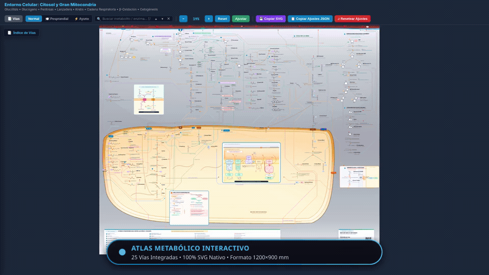

<div align="center">


<br/>

[](https://amorales22t.github.io/mapa_metabolico/)
[](LICENSE)
[](#vias-incluidas-25)
[](#arquitectura-y-motor-tecnico)
[](#caracteristicas-principales)
[](#contenido-y-formatos-disponibles)

**Material didáctico integral e interactivo para la asignatura *Metabolismo y su regulación***  
*Grado en Biología • Universidad de Navarra*

[🌐 Abrir Aplicación Web](https://amorales22t.github.io/mapa_metabolico/) • [📄 Descargar PDF (120×90 cm)](mapa_metabolico_alternativo/mapa_metabolico_alternativo_120x90cm.pdf) • [📄 Descargar PDF (100×70 cm)](versiones_impresion/01_mapa_ampliado_completo_100x70cm.pdf)

</div>

---

## Tabla de Contenidos

- [Introducción](#introduccion)
- [Demostración en Vivo](#demostracion-en-vivo)
- [Características Principales](#caracteristicas-principales)
- [Guía Rápida de Uso](#guia-rapida-de-uso)
- [Vías Incluidas (25)](#vias-incluidas-25)
- [Contenido y Formatos Disponibles](#contenido-y-formatos-disponibles)
- [Arquitectura y Motor Técnico](#arquitectura-y-motor-tecnico)
- [Ejecución Local](#ejecucion-local)
- [Autoría y Licencia](#autoria-y-licencia)

---

## Introducción

Este proyecto es una plataforma didáctica visual y computacional desarrollada para la asignatura de **Metabolismo y su regulación** dentro del Grado en Biología de la Universidad de Navarra. Se trata de un atlas metabólico interactivo y autónomo, programado íntegramente sobre **SVG nativo** y **JavaScript vanilla** sin dependencias externas ni frameworks pesados. 

El atlas integra **veinticinco vías metabólicas** en un único lienzo vectorial de escala mural (1200 × 900 mm y versión estándar 1000 × 700 mm), situando cada reacción enzimática dentro de su compartimento celular específico (citosol, matriz mitocondrial, membrana interna, retículo endoplásmico, torrente vascular y tejidos periféricos).

Permite recorrer el metabolismo intermediario a tres niveles complementarios:
1. **Visión Panorámica Celular:** Localización espacial de intermediarios, lanzaderas y transportadores de membrana.
2. **Navegación Bioquímica Guiada:** Análisis reacción por reacción con códigos EC, cofactores, balances termodinámicos ($\Delta G^{\circ\prime}$) y control alostérico/covalente.
3. **Simulación Dinámica de Flujos:** Monitores especializados para la Cadena Respiratoria (Complejos I–IV y rotor $F_0F_1$), lanzaderas mitocondriales redox (malato-aspartato y glicerol-3-P) y conmutación de estados fisiológicos (normal, posprandial y ayuno).

| Métrica | Especificación |
| :--- | :--- |
| **Vías metabólicas integradas** | 25 completas e interconectadas |
| **Resolución del lienzo maestro** | 7320 × 5120 px (1200 × 900 mm a 150 ppp) |
| **Formatos listos para imprenta** | 120 × 90 cm y 100 × 70 cm (PDF vectorial CMYK/RGB) |
| **Tecnología de renderizado** | 100% SVG nativo W3C DOM |
| **Dependencias externas** | 0 (Vanilla JS puro, sin bibliotecas externas) |
| **Rendimiento de animación** | 60 FPS estables vía SMIL (`<animateMotion>`) y CSS GPU |
| **Despliegue y CI/CD** | GitHub Actions automatizado a GitHub Pages |
| **Licencia académica** | Creative Commons Atribución-NoComercial-SinDerivadas 4.0 |

---

## Demostración en Vivo

<div align="center">

[](https://amorales22t.github.io/mapa_metabolico/)

*Animación interactiva del mapa: vista celular, aislamiento del Ciclo de Krebs, monitor de CTE y rotor ATP sintasa, lanzadera malato-aspartato, fichas enzimáticas y corriente bioluminiscente.*

👉 **Explorar online sin instalación:** [https://amorales22t.github.io/mapa_metabolico/](https://amorales22t.github.io/mapa_metabolico/)

</div>

### Escenas Destacadas en la Demostración:
* **01. Arquitectura Celular Panorámica:** Distribución integrada citosol-mitocondria con membranas lipídicas bicapa y torrente vascular superior.
* **02. Aislamiento y Resplandor de Vías:** Foco selectivo con atenuación inteligente del fondo (resaltado ámbar del Ciclo de Krebs).
* **03. Cadena Respiratoria y Rotor $F_0F_1$:** Monitor detallado de los Complejos I, II, III y IV, bombeo de protones ($H^+$) y síntesis quimiosmótica de ATP.
* **04. Lanzaderas Redox Mitocondriales:** Lanzadera de malato-aspartato con transportadores SLC25A11 (OGC) y SLC25A12 (Aralar).
* **05. Regulación Enzimática Alostérica y Hormonal:** Fichas modulares con efectores positivos (+), negativos (-), fosforilaciones y ratio insulina/glucagón.
* **06. Corriente Bioluminiscente a 60 FPS:** Partículas SMIL vectoriales que trazan el sentido real del flujo metabólico sin sobrecargar la CPU.

---

## Características Principales

| Módulo | Funcionalidad y Valor Didáctico |
| :--- | :--- |
| **Índice Lateral de Vías (25)** | Panel desplegable con buscador en tiempo real. Al hacer clic en cualquier ruta, la cámara centra suavemente la vista, atenúa las rutas ajenas y enciende los metabolitos e interconexiones activas. |
| **Navegación Pan-Zoom Vectorial** | Desplazamiento libre mediante puntero o gestos táctiles, con zoom dinámico infinito que conserva la nitidez cristalina en fórmulas químicas y textos. |
| **Modo Didáctico Paso a Paso** | Desglose secuencial de las reacciones de la ruta activa: ecuación química estequiométrica, enzima, código EC, cofactores y mecanismo de control. |
| **Modo Lectura de Alto Contraste** | Optimiza el grosor tipográfico, amplía las conexiones inter-ruta y añade siluetas de contraste a los rótulos para proyecciones en clase o pantallas con luz ambiente. |
| **Modo Aislar Vía** | Oculta completamente los elementos secundarios para un estudio limpio y focalizado de una ruta individual. |
| **Simulador de Lanzaderas y Monitor CTE** | Acceso interactivo por lupas vectoriales a monitores ampliados: Complejos I–IV, rotación $\gamma$ de la ATP sintasa, malato-aspartato, glicerol-3-P y carnitina. |
| **Conmutador de Estados Fisiológicos** | Cambio instantáneo entre estado **Normal**, **Posprandial** (insulina alta, glucagón bajo) y **Ayuno** (glucagón alto, lipólisis y gluconeogénesis activas). |
| **Flujo Bioluminiscente Activado** | Trazado cinético de electrones y carbonos mediante partículas bioluminiscentes SMIL (`<animateMotion>`), pausables con un clic para lectura en reposo. |

---

## Guía Rápida de Uso

1. **Selección rápida o Índice lateral:** Pulsa el botón **Vías (25)** en la barra superior o despliega el selector rápido para navegar directamente a cualquiera de las 25 rutas.
2. **Navegación espacial:** Arrastra el lienzo con el ratón o trackpad. Usa la rueda o los botones `+` / `−` para hacer zoom; pulsa `Reset` o `Ajustar` (tecla `F`) para restablecer la vista completa.
3. **Búsqueda instantánea:** Presiona la tecla `/` o escribe en el cajetín **BUSCAR** para localizar cualquier metabolito o enzima (ej. *Citrato*, *PFK-1*, *Malonil-CoA*). Usa `Enter` o las flechas para saltar entre coincidencias.
4. **Ficha de regulación:** Haz clic sobre cualquier enzima o reacción para desplegar su ficha interactiva con balance libre ($\Delta G^{\circ\prime}$), efectores alostéricos ($+$ / $-$) y cascada hormonal.
5. **Simuladores de Transporte y CTE:** Pulsa sobre las lupas rotuladas como **CTE** o **Lanzaderas** para abrir los paneles de respiración celular y transporte redox.
6. **Estados fisiológicos:** Conmuta entre **Normal**, **Posprandial** y **Ayuno** para observar cómo se reorganiza el tráfico metabólico entre hígado, músculo, tejido adiposo y cerebro.
7. **Acceso directo por URL:** Puedes compartir o enlazar cualquier ruta añadiendo `?via=N` (de 1 a 25) o `?state=ayuno` a la dirección web (ej. `?via=6` para el Ciclo de Krebs).

---

## Vías Incluidas (25)

Las veinticinco rutas metabólicas cubren el programa completo de la asignatura estructuradas en siete bloques temáticos integrados:

### Bloque I. Metabolismo de Carbohidratos
* **1. Glucólisis:** 10 reacciones citosólicas, hexocinasa, PFK-1, piruvato quinasa, balance ATP/NADH.
* **2. Gluconeogénesis:** Rodeos enzimáticos (piruvato carboxilasa, PEPCK, FBPasa-1, glucosa-6-fosfatasa).
* **3. Glucogenogénesis y Glucogenólisis:** Regulación recíproca por glucógeno sintasa y glucógeno fosforilasa.
* **4. Vía de las Pentosas Fosfato:** Fase oxidativa generadora de NADPH (G6PDH) y fase no oxidativa (transcetolasa/transaldolasa).

### Bloque II. Respiración Celular y Bioenergética
* **5. Complejo Piruvato Deshidrogenasa (PDH):** E1, E2, E3, cofactores (TPP, lipoamida, CoA, FAD, NAD⁺) y control por PDK/PDP.
* **6. Ciclo de Krebs (ATC):** 8 etapas matriciales, citrato sintasa, isocitrato DH, α-cetoglutarato DH, balance redox.
* **7. Cadena Respiratoria y ATP Sintasa:** Complejos I–IV, coenzima Q, citocromo c, bombeo de $H^+$ y rotor $F_0F_1$.

### Bloque III. Lanzaderas Mitocondriales
* **8. Lanzadera Malato-Aspartato:** Transportadores OGC (SLC25A11) y Aralar/AGC (SLC25A12), rescate de NADH citosólico.
* **8B. Lanzadera Glicerol-3-Fosfato:** g3pDH citosólica y mitocondrial con flavoproteína de membrana interna.
* **9. Lanzadera de Carnitina:** CPT-1 (inhibida por malonil-CoA), translocasa CACT y CPT-2.

### Bloque IV. Metabolismo Lipídico y Cuerpos Cetónicos
* **9. $\beta$-Oxidación de Ácidos Grasos:** Espiral de Lynen en matriz mitocondrial (deshidrogenación, hidratación, tiólisis).
* **10. Lipogénesis de Novo:** ATP citrato liasa, acetil-CoA carboxilasa (ACC) y complejo ácido graso sintasa (FAS).
* **11. Cetogénesis y Cetólisis:** Síntesis hepática de acetoacetato y $\beta$-hidroxibutirato; destino oxidativo cerebral.
* **12. Biosíntesis de Colesterol:** Vía del mevalonato, HMG-CoA reductasa (diana de estatinas), escualeno y cascada cicladora.

### Bloque V. Nitrógeno y Aminoácidos
* **12B. Vía de Transulfuracion (CTH):** Metabolismo de metionina y homocisteína hacia cisteína.
* **13. Transaminación y Ciclo Glucosa-Alanina:** Acoplamiento aminotransferasa (ALT, AST) entre músculo e hígado.
* **14. Ciclo de la Urea:** Biciclo de Krebs-Henseleit compartimentado (matriz y citosol) con excreción nitrogenada.

### Bloque VI. Metabolismo de Nucleótidos
* **15. Biosíntesis de Purinas y Pirimidinas:** Rutas de novo y vías de salvamento dependientes de PRPP.
* **16. Catabolismo de Nucleótidos y Ácido Úrico:** Degradación oxidativa a urato y transporte renal (URAT1).

### Bloque VII. Integración Tisular e Interórganos
* **17. Ciclo de Cori y Ciclo de Cahill:** Integración lactato/glucosa y alanina/glucosa en esfuerzo y ayuno.
* **18. Digestión y Absorción de Lípidos:** Formación enterocítica de micelas y quilomicrones linfáticos.
* **19. Lipólisis Adipocitaria:** Cascada lipolítica regulada por ATGL, HSL y MGL bajo control adrenérgico.
* **20. Músculo Esquelético y Sarcómero:** Entrada de glucosa dependiente de GLUT-4, creatina fosfato y tipos de fibra.
* **21. Cerebro y Barrera Hematoencefálica:** Transporte de metabolitos por GLUT-1 y MCT1, adaptación cetolítica en ayuno.
* **22. Metabolismo de Lipoproteínas Plasmáticas:** VLDL, IDL, LDL, HDL, lipoproteína lipasa (LPL) y aclaramiento hepático.
* **23. Vía de Kennedy:** Biosíntesis de novo de fosfolípidos de membrana celular.
* **24. Biosíntesis de Aminoácidos No Esenciales:** Rutas anfibólicas derivadas de intermediarios glucolíticos y de Krebs.
* **25. Conmutador Hormonal Pancreático:** Células $\alpha$ y $\beta$, secreción coordinada de insulina, glucagón y somatostatina.

---

## Contenido y Formatos Disponibles

| Recurso | Formato / Escala | Ubicación |
| :--- | :--- | :--- |
| **Mapa Interactivo Principal** | Aplicación web SVG + JS Vanilla | [`index.html`](index.html) |
| **Mapa Alternativo (Flujo Continuo)** | Visor alternativo con SMIL en vivo | [`mapa_metabolico_alternativo/`](mapa_metabolico_alternativo/) |
| **Póster de Imprenta (120 × 90 cm)** | PDF vectorial gigante para plotter | [`versiones_impresion/01_mapa_ampliado_completo_120x90cm.pdf`](versiones_impresion/01_mapa_ampliado_completo_120x90cm.pdf) |
| **Póster de Imprenta (100 × 70 cm)** | PDF vectorial estándar B1 / imprenta | [`versiones_impresion/01_mapa_ampliado_completo_100x70cm.pdf`](versiones_impresion/01_mapa_ampliado_completo_100x70cm.pdf) |
| **Diagrama Vectorial 100×70 cm** | Archivo SVG editable a escala | [`versiones_impresion/mapa_metabolico_100x70cm.svg`](versiones_impresion/mapa_metabolico_100x70cm.svg) |
| **Imágenes en Ultra-HD (10000 px)** | PNG / JPG de máxima definición | [`versiones_impresion/`](versiones_impresion/) |
| **Vías Individuales Modulares** | Diagramas SVG aislados por bloque | [`01_CARBOHIDRATOS/`](01_CARBOHIDRATOS/) a [`05_NUCLEOTIDOS_Y_OTRAS/`](05_NUCLEOTIDOS_Y_OTRAS/) |

---

## Arquitectura y Motor Técnico

```
+--------------------------------------------------------------------------+
|                        ARQUITECTURA DEL ATLAS                            |
+--------------------------------------------------------------------------+
|                                                                          |
|   [ NAVEGADOR WEB MODERNO ]                                              |
|        │                                                                 |
|        ▼                                                                 |
|   ┌───────────────────┐        ┌───────────────────┐                     |
|   │   index.html      │  <──>  │  SVG Nativo W3C   │                     |
|   │   (UI DOM)        │        │  (7320 × 5120 px) │                     |
|   └───────────────────┘        └───────────────────┘                     |
|        │                          ▲                                      |
|        ▼                          │                                      |
|   ┌───────────────────┐        ┌───────────────────┐                     |
|   │  Motor JS Vanilla │  ────> │  SMIL + CSS GPU   │                     |
|   │  (pan-zoom, step, │        │  (partículas 60fps│                     |
|   │   tooltip alost.) │        │   bioluminiscentes│                     |
|   └───────────────────┘        └───────────────────┘                     |
|        │                                                                 |
|        ▼                                                                 |
|   ┌───────────────────┐                                                  |
|   │  GitHub Actions   │  ────> push main ────> Despliegue automático     |
|   │  deploy.yml       │                        en GitHub Pages           |
|   └───────────────────┘                                                  |
|                                                                          |
+--------------------------------------------------------------------------+
```

1. **SVG Nativo como Grafo DOM:** Todas las vías, metabolitos y enzimas son nodos SVG estándar consultables y modificables mediante la API DOM de JavaScript (`document.getElementById`), permitiendo resaltados instantáneos sin el sobrecoste de WebGL ni repintados masivos de Canvas raster.
2. **Animación Bioluminiscente Eficiente:** Las partículas se mueven siguiendo rutas `<path>` mediante `<animateMotion>` de SMIL combinadas con transiciones CSS aceleradas por GPU, manteniendo 60 FPS estables y con opción de pausa instantánea para optimizar el consumo de batería.
3. **Cero Dependencias y Despliegue Continuo:** El repositorio no requiere `npm install`, frameworks pesados ni compiladores. Un flujo de GitHub Actions despliega cualquier actualización en GitHub Pages en segundos.

---

## Ejecución Local

Para ejecutar el atlas localmente basta con servir los archivos mediante cualquier servidor HTTP estático (necesario para permitir la resolución correcta de recursos SVG por las políticas de seguridad del navegador):

```bash
# Servir con Python 3 (incorporado en Linux, macOS y Windows):
python3 -m http.server 8000
```

Abre tu navegador en:
```
http://localhost:8000/
```

*Alternativas equivalentes:* `npx serve`, `php -S localhost:8000` o la extensión *Live Server* de VS Code / IDE.

---

## Autoría y Licencia

**Autor:** **Adolfo Morales Tena** ([AMorales22T](https://github.com/AMorales22T))  
*Estudiante del Grado en Biología • Universidad de Navarra*  
Repositorio oficial: [https://github.com/AMorales22T/mapa_metabolico](https://github.com/AMorales22T/mapa_metabolico)

**Asignatura:** Metabolismo y su regulación (segundo curso, Grado en Biología).  
**Agradecimientos:** Al profesorado y departamento de Bioquímica de la Universidad de Navarra por la orientación académica y el apoyo en la integración intertisular de las rutas metabólicas.

Este proyecto se distribuye bajo la licencia internacional **Creative Commons Atribución-NoComercial-SinDerivadas 4.0 (CC BY-NC-ND 4.0)**.  
Consulta el texto legal íntegro en [LICENSE](LICENSE) o en [creativecommons.org](https://creativecommons.org/licenses/by-nc-nd/4.0/).

* **Permitido:** Compartir, proyectar y utilizar con fines de estudio personal, docencia académica y divulgación científica no comercial, manteniendo la atribución original.
* **No comercial:** Prohibida su venta o uso en plataformas de pago sin consentimiento expreso por escrito.
* **Sin obras derivadas:** Prohibida la redistribución de copias alteradas o sin la acreditación correspondiente.

```
+--------------------------------------------------------------------------+
|   © Adolfo Morales Tena (AMorales22T)  •  Universidad de Navarra         |
|   Atlas de Metabolismo y su Regulación  •  Licencia CC BY-NC-ND 4.0       |
+--------------------------------------------------------------------------+
```
