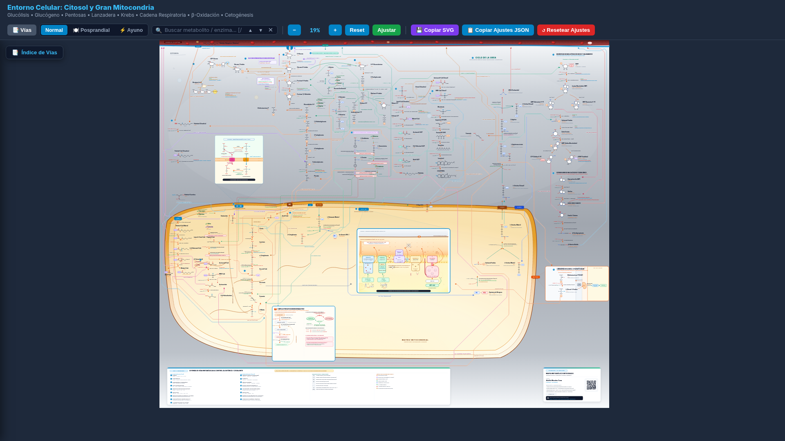
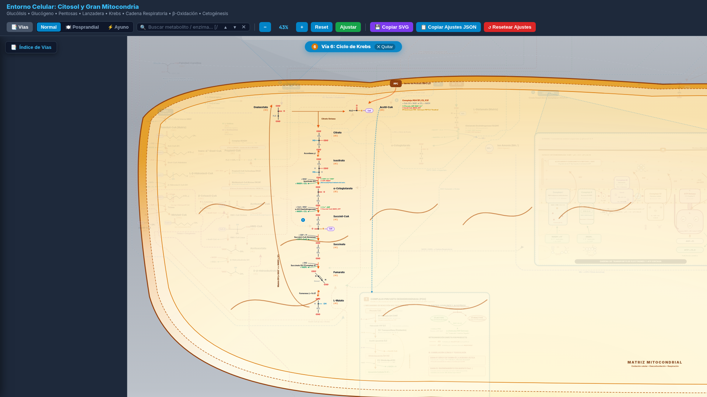
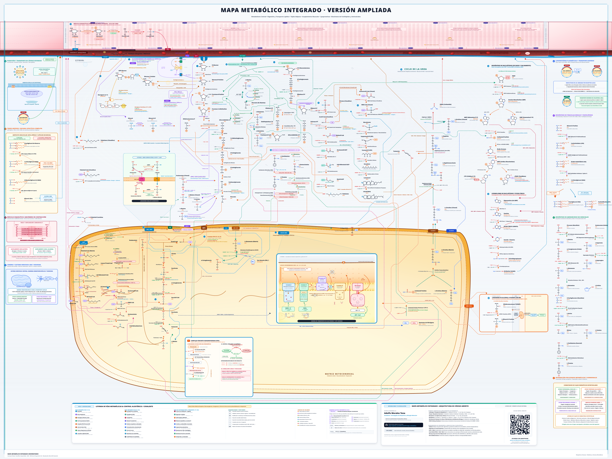

# 🧬 Mapa Metabólico Celular Integrado

> **Atlas Bioquímico Vectorial (1200 × 900 mm) & Herramienta Web Interactiva**  
> *25 rutas metabólicas interconectadas algorítmicamente mediante $A^*$ sobre SVG puro.*

<p align="center">
  <a href="https://amorales22t.github.io/mapa_metabolico/">
    
  </a>
  
  
</p>

---

## 📸 Vista Previa

<p align="center">
  <a href="https://amorales22t.github.io/mapa_metabolico/">
    
  </a>
  <br>
  <em>🌐 <strong><a href="https://amorales22t.github.io/mapa_metabolico/">Haz clic aquí para abrir la demo interactiva en GitHub Pages</a></strong></em>
</p>

<p align="center">
  
  
</p>

---

## ⚡ ¿Qué es este proyecto?

Un atlas visual y didáctico de bioquímica celular que integra **25 vías metabólicas** en un único lienzo continuo: hepatocito central, músculo esquelético, tejido adiposo, barrera hematoencefálica y torrente vascular.

* 🗺️ **25 Vías Integradas:** Glucólisis, Gluconeogénesis, Glucógeno, Pentosas Fosfato, PDH, Ciclo de Krebs, Cadena Respiratoria, Lanzaderas Redox, $\beta$-Oxidación, Lipogénesis, Cetogénesis, Colesterol, Transaminación, Ciclo de la Urea, Nucleótidos, Ciclo de Cori, Digestión lipídica, Cascada ATGL/HSL/MGL, Sarcómero, Neurona/BHE, Lipoproteínas y Vía de Kennedy.
* 🤖 **Algoritmo de Pathfinding A\*:** Las 45 conexiones inter-ruta fueron calculadas algorítmicamente sobre una cuadrícula ortogonal de **$484 \times 427$ celdas**, evitando más de 3.900 obstáculos biológicos (membranas, enzimas y metabolitos) sin cruces destructivos.
* 🖥️ **Visor Web 100% Nativo:** Navegación afín suave (CTM pan/zoom), buscador diacrítico instantáneo, fichas flotantes de enzimas y modulador de estados nutricionales (**Normal**, **Posprandial**, **Ayuno**). Cero frameworks pesados.
* 🖨️ **Formato Cartulina / Póster (1200 × 900 mm):** Archivos PDF y SVG compilados a escala física con tipografías vectoriales incrustadas en base64 y código QR integrado.

---

## 🚀 Entregables y Acceso Rápido

| Formato | Recurso | Descripción |
| :---: | :--- | :--- |
| 🌐 **Web** | **[Visor Interactivo Principal (25 Vías)](https://amorales22t.github.io/mapa_metabolico/)** | El mapa ampliado a pantalla completa listo para estudiar |
| 🌐 **Web** | [Ampliación Vías 18 a 25](versiones_html/02_ampliacion_rutas_18_25.html) | Visor enfocado exclusivamente en vías periféricas |
| 🌐 **Web** | [Cuadro Temario (Bloques A–E)](versiones_html/04_cuadro_temario_bloques_A_E.html) | Cuadro de estudio con tablas de cofactores y regulación |
| 🌐 **Web** | [Centro de Visores / Hub](versiones_html/centro_visores.html) | Portal con tarjetas de selección y descargas |
| 🖨️ **PDF** | [Póster Completo 120×90 cm](versiones_impresion/01_mapa_ampliado_completo_120x90cm.pdf) | PDF vectorial Ultra-HD de 25 vías para imprenta |
| 🖨️ **PDF** | [Póster Central 120×90 cm](versiones_impresion/03_mapa_central_original_120x90cm.pdf) | PDF del hepatocito central (17 vías troncales) |

---

## 📂 Estructura del Repositorio

```text
├── scripts_generacion/    # Generadores Python 3 (motor SVG, A* pathfinding, CLI)
├── versiones_html/        # Entregables interactivos HTML5/SVG (desplegados en GitHub Pages)
├── versiones_impresion/   # PDFs vectoriales Ultra-HD (1200 × 900 mm) listos para imprenta
├── capturas_y_pruebas/    # Capturas de pantalla, validaciones visuales y comprobaciones
├── 01 a 05 (Módulos)/     # Código fuente por familia bioquímica (Carbohidratos, Lípidos, etc.)
├── 06_REGULACION_Y_LEYENDA/ # Catálogo de efectores ⊕/⊖, fosforilaciones y números EC
└── 07_AMPLIACION_TEMARIO/ # Ensamblador del mapa ampliado (7320 × 5490 px) y vías 18 a 25
```

---

## 🛠️ Generación desde Código Fuente

El proyecto solo requiere **Python 3** (sin librerías complejas):

```bash
# 1. Regenerar el mapa ampliado completo de 25 vías (HTML y PDF)
python3 07_AMPLIACION_TEMARIO/generar_ampliacion.py

# 2. O recalcular el trazado A* de las 45 conexiones inter-ruta
python3 scripts_generacion/conectar_rutas.py
```

---

## 📚 Bibliografía y Referencias

Contraste bioquímico riguroso con la literatura estándar internacional:
* **Lehninger:** *Principios de Bioquímica* (8.ª ed., Nelson & Cox)
* **Harper:** *Bioquímica Ilustrada* (32.ª ed., Rodwell et al.)
* **Stryer:** *Bioquímica* (9.ª ed., Berg et al.)
* **KEGG:** *Kyoto Encyclopedia of Genes and Genomes* (Homo sapiens Pathway Maps)

---

## 👤 Autoría y Licencia

* **Autor:** **Adolfo Morales Tena** ([@AMorales22T](https://github.com/AMorales22T))
* **Licencia:** Código y diseños distribuidos bajo licencia abierta [MIT](LICENSE).
